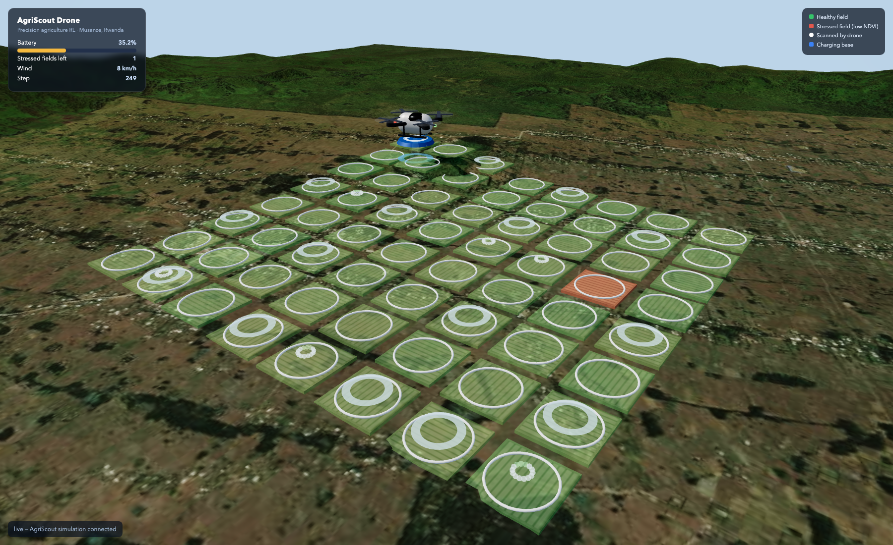

# AgriScout — Mission-Based Reinforcement Learning

A precision-agriculture drone learns to protect farmland in **Musanze, Rwanda**: it scans
fields with a multispectral camera, finds crop stress (low NDVI) before it spreads to
neighbouring fields, treats the right fields, and manages its battery by returning to a
charging base. Four RL methods — **DQN, REINFORCE, PPO and A2C** — are trained with
[TorchRL](https://github.com/pytorch/rl) on the same custom Gymnasium environment and
compared. The live 3D visualization renders the agent over **real Rwandan terrain**
(elevation from the AWS Terrain Tiles API, satellite imagery from Esri World Imagery)
using three.js, streamed from Python over WebSocket.



## Quick start

```bash
git clone <this-repo>
cd <this-repo>
uv sync
uv run main.py        # opens the 3D viewer and runs the best trained agent
```

No manual dependency installs or virtualenvs needed — `uv` handles everything. `main.py`
loads the best model recorded in `logs/`, opens the viewer at `http://localhost:8000`, and
narrates every agent decision in the terminal.

## The environment

| Component | Design |
|---|---|
| Agent | A scouting UAV over an 8×8 grid of fields |
| Actions (7, discrete) | move N/S/E/W, scan (3×3 camera footprint), treat, charge (at base) |
| Observations (19 floats) | GPS position, battery level, 3×3 known-NDVI patch, vector to base, vector to nearest known stressed field, wind, time left |
| Rewards | +10 treat stressed, −5 treat healthy, +0.25 per newly scanned field, −0.1/step, −60 battery crash, +25 farm cleared, plus potential-based shaping toward the nearest known stressed field |
| Start | Drone at base, full battery, hidden stress pattern, partial satellite NDVI pre-scan |
| Terminal | Battery dies away from base, all stress cleared, or 250 steps |

Stress spreads to neighbouring fields over time, so decisions have delayed consequences:
scanning now pays off later, and ignoring a distant stressed field lets it infect its
neighbours.

## Training and experiments

```bash
uv run python training/dqn_training.py                 # full DQN sweep (12 runs)
uv run python training/pg_training.py --algo reinforce # REINFORCE sweep (11 runs)
uv run python training/pg_training.py --algo ppo       # PPO sweep (11 runs)
uv run python training/pg_training.py --algo a2c       # A2C sweep (11 runs)
```

Every run logs its config, episode returns, loss/entropy curves and evaluation scores to
`logs/<algo>/<run>.json`, and saves trained weights to `models/`. The notebook
`notebooks/analysis.ipynb` builds the hyperparameter tables and all comparison figures
from those logs.

## Demo

```bash
uv run main.py --episodes 3          # best model overall
uv run main.py --algo ppo            # best PPO model
uv run play.py                       # identical entry point
```

`main.py` starts a local HTTP + WebSocket server, opens the three.js viewer at
`http://localhost:8000`, and narrates every agent step in the terminal. Terrain tiles are
cached in `assets/viewer/terrain/` (re-fetch with `uv run python assets/fetch_terrain.py`).

## Project structure

```
├── main.py                  # run the best agent in the 3D viewer
├── play.py                  # same demo, alternative entry point
├── environment/
│   ├── custom_env.py        # AgriScout Gymnasium environment
│   └── rendering.py         # WebSocket bridge to the three.js viewer
├── training/
│   ├── common.py            # env factory, networks, logging, evaluation
│   ├── dqn_training.py      # DQN trainer + hyperparameter sweep
│   └── pg_training.py       # REINFORCE / PPO / A2C trainers + sweeps
├── assets/
│   ├── viewer/              # three.js viewer (vendored, offline-capable)
│   └── fetch_terrain.py     # downloads real Musanze terrain + imagery
├── notebooks/
│   ├── environment_demo.ipynb  # interactive walkthrough of the environment
│   └── analysis.ipynb          # tables + figures for the report
├── report/build_report.py   # generates the submission .docx from logs + figures
├── models/                  # trained weights (dqn/, pg/)
├── logs/                    # one JSON per experiment
└── tests/                   # environment unit tests (uv run pytest)
```

## Results

All four methods were trained on the identical environment for 250,000 frames per run.
Each run is scored by greedy evaluation on 20 held-out seeds.

| Method | Best configuration | Mean reward | Unseen regime |
|---|---|---|---|
| PPO | `r03_high_lr` (lr 3e-3) | **+135.6** | **+153.3** |
| DQN | `r09_soft_target` (Polyak τ=0.99) | +43.4 | +66.5 |
| A2C | `r10_big_rollout` (1024-step rollout) | −39.3 | −57.4 |
| REINFORCE | `r01_baseline` | −58.3 | −59.7 |

On the same 20 evaluation seeds, a random policy scores −112.0 (clearing 0/20 farms, wasting 268
sprays) and a hand-coded expert heuristic scores +130.8 (clearing 19/20). The learned PPO agent
matches that hand-designed strategy without being told it, clearing farms in as few as 34 steps
with zero wasted sprays. Reproduce the reference scores with
`uv run python training/baselines.py`.

Reproduce the figures and the report:

```bash
uv run jupyter nbconvert --to notebook --execute --inplace notebooks/analysis.ipynb
uv run python report/build_report.py
```
